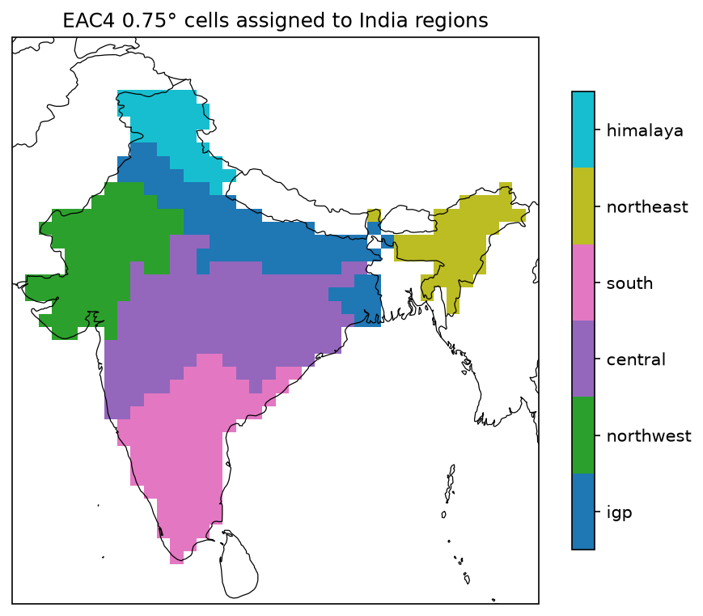
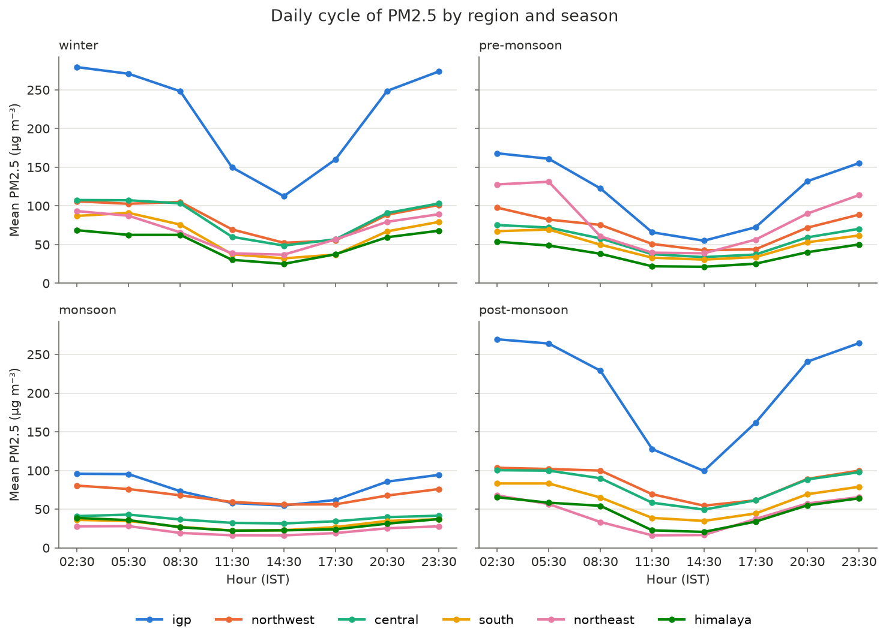
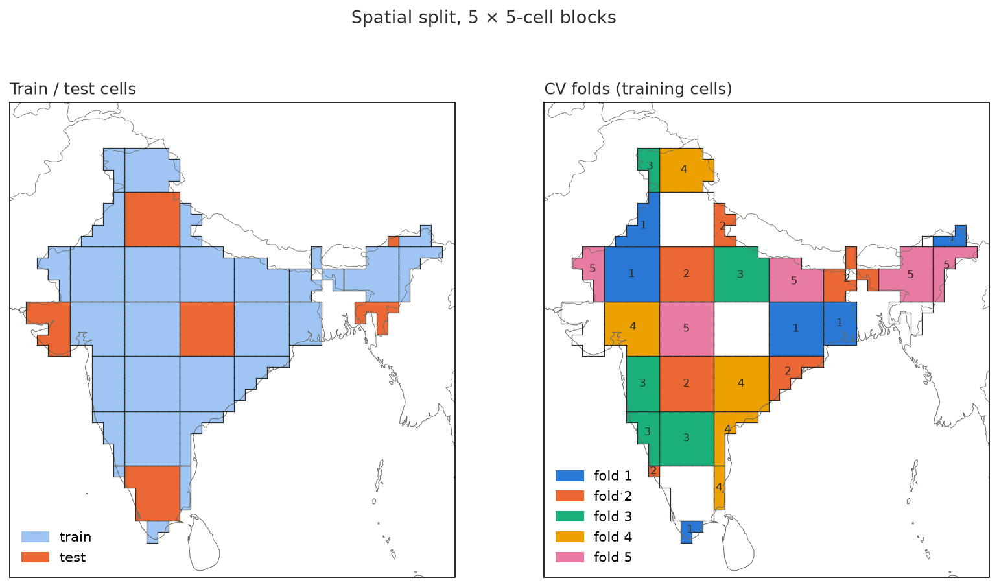
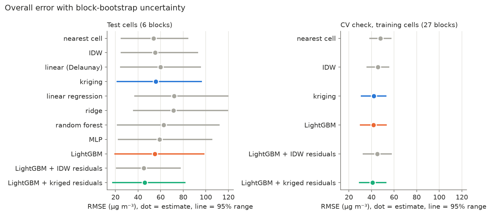
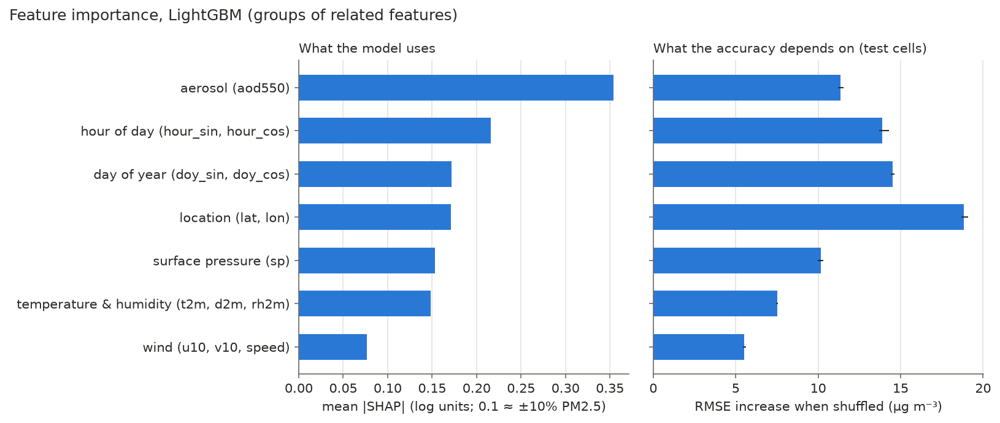
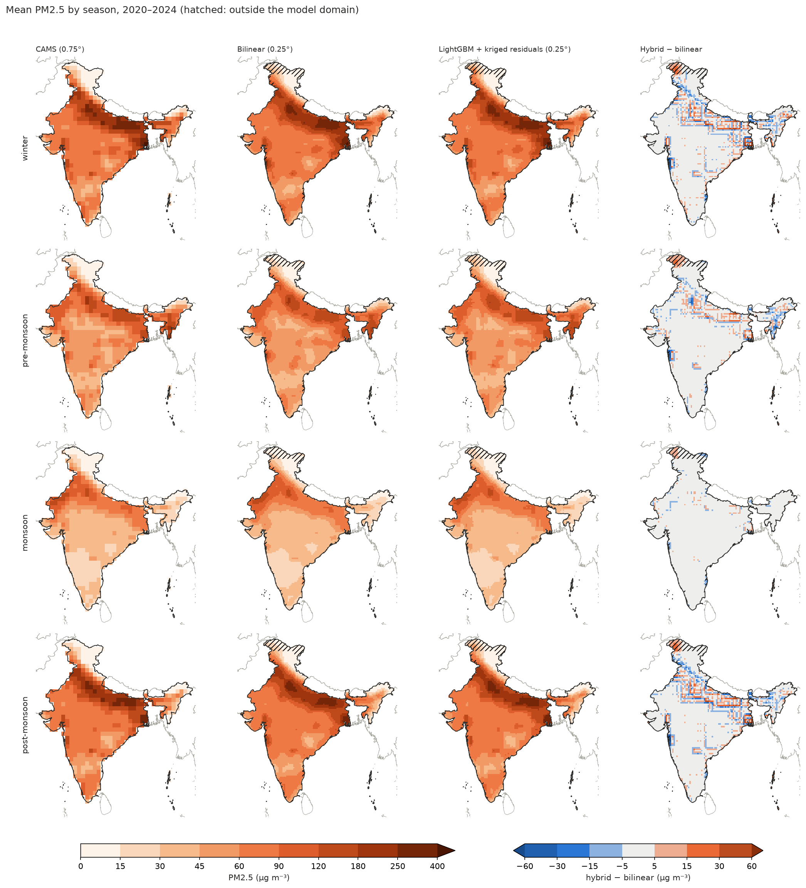

```{=typst}
#pagebreak()
#align(center + horizon)[#text(24pt, weight: "bold")[Part II] #v(0.3em) #text(18pt)[The project step by step]]
#pagebreak()
```

# Step 01: Downloading the data

**In one sentence:** fetch five years of CAMS data for India from the internet,
one month at a time, in a way that survives interruptions.

**What and why.** CAMS data lives on the Copernicus *Atmosphere Data Store*
(ADS). You send it a *request* (which variables, which days, which hours, which
area), the request waits in a queue, and then you download a file. We need seven
variables for 60 months.

**How.** One request per month keeps each job small. The script:

- skips a month whose file already exists, so a crashed run can simply be
  started again;
- downloads to a temporary name (`….nc.part`) and renames the file only when it
  is complete, so a half-downloaded file is never mistaken for a finished one;
- logs every failure and moves on, listing failed months at the end.

**What happened.** All 60 files (381 MB in total, NetCDF format) arrived after
about **5¾ hours**, slower than expected because the ADS servers kept dropping
connections; the download client retried automatically.

*Code:* `src/pm25/download.py`, `scripts/download_eac4.py` (chapter 19).

# Step 02: Which grid cells are "India"?

**In one sentence:** decide, for every 80 km grid cell, whether it belongs to
India and to which of six regions.

**Why.** The download box also contains sea, Pakistan, Nepal, Tibet, Bangladesh
and Myanmar. Their pollution has different sources, so the project uses only
Indian cells. We also need **regions**, because question 4 asks how results vary
across India.

**How.** We take the outlines of India's states from *Natural Earth* (a free map
dataset), and for each grid cell compute what fraction of its area lies inside
India and which state covers most of it. A cell counts as India if **at least
50%** of it is inside. Each state belongs to one of six regions:

| Region | States / union territories |
|---|---|
| IGP (Indo-Gangetic Plain) | Punjab, Haryana, Delhi, Chandigarh, Uttar Pradesh, Bihar, West Bengal |
| northwest | Rajasthan, Gujarat, Dadra & Nagar Haveli and Daman & Diu |
| central | Madhya Pradesh, Chhattisgarh, Jharkhand, Odisha, Maharashtra |
| south | Andhra Pradesh, Telangana, Karnataka, Goa, Kerala, Tamil Nadu, Puducherry |
| northeast | Assam, Arunachal Pradesh, Meghalaya, Manipur, Mizoram, Nagaland, Tripura, Sikkim |
| Himalaya | Jammu & Kashmir, Ladakh, Himachal Pradesh, Uttarakhand |

**What we found.** **494 cells** are India: IGP 84, northwest 83, central 150,
south 97, northeast 43, Himalaya 37. The 50% rule leaves out 127 border and
coast cells, including the cells of **Mumbai** (30% inside India) and
**Chennai** (47%); this was discussed and kept as a known limitation. Delhi's
cell is labelled Haryana (Haryana covers more of it), which doesn't matter
because both are in the IGP region.

{width=70%}

*Code:* `src/pm25/regions.py`, `scripts/build_region_mask.py`.

# Step 03: Cleaning and preparing the data

**In one sentence:** join the 60 monthly files into one tidy dataset with
sensible units and some extra, derived variables.

**How.**

1. **Tidy names and order**: dimensions are called `time`, `lat`, `lon`;
   latitude runs south to north.
2. **Units**: PM2.5 from kg m⁻³ to **µg m⁻³** (× 10⁹); temperatures from Kelvin
   to **°C**; pressure from Pa to **hPa**.
3. **Derived variables**:
   - **wind speed** = √(u10² + v10²) (Pythagoras on the two wind components);
   - **relative humidity** from temperature and dew point (Magnus formula);
   - **local solar hour**: the clock time set by the Sun at that longitude
     (UTC + longitude/15 hours), because the daily cycle of pollution follows the
     Sun, not the time zone;
   - **day of year**.
4. **Cyclic encoding**: hour and day of year are written as *sine and cosine*
   pairs. Why? As plain numbers, 23:00 and 01:00 look far apart (23 vs 1), but
   they are only two hours apart; on a circle (sin, cos) they are neighbours.
5. **Seasons** as defined by the India Meteorological Department (IMD):
   winter (Jan–Feb), pre-monsoon (Mar–May), monsoon (Jun–Sep), post-monsoon
   (Oct–Dec).

**What we found.** 14,616 time steps, every gap exactly 3 hours, **no missing
values**. PM2.5 over India: mean 72, median 52, maximum **5,651 µg m⁻³** (Assam,
March 2021, a fire). 2020 had the lowest yearly mean (66 µg m⁻³), consistent with
the COVID-19 lockdown. The final file is 632 MB.

*Code:* `src/pm25/preprocess.py`, `scripts/preprocess_eac4.py`.

# Step 04: Exploring the data

**In one sentence:** look at the data from every angle before modelling, to
understand its patterns and to choose how to test the models fairly.

**Patterns in PM2.5.**

- The **Indo-Gangetic Plain is 2–4 times more polluted** than the rest of India
  in winter (mean 218 µg m⁻³) and post-monsoon (207).
- The **northeast peaks in March** (fire season); no other region does.
- Every region is **cleanest in the monsoon** (rain washes particles out), except
  that the northwest stays fairly high (desert dust).
- A strong **daily cycle**: highest at night and early morning (02:30–05:30
  Indian time), lowest in the afternoon (14:30). At night the lowest layer of the
  atmosphere (the *boundary layer*) is shallow and traps pollution; in the
  afternoon the Sun heats the ground and mixes pollution upwards.

{width=95%}

**Which variables go with PM2.5?** We used the *Spearman correlation*, a number
from −1 to +1 telling how consistently two things rise and fall together. AOD has
the strongest link (0.60). Surface pressure follows (0.43), because it mostly
measures altitude: low plains are polluted, mountains are clean. Humidity matters
only in winter (foggy nights), and temperature even **changes sign** between
seasons (−0.30 in winter, +0.34 in the monsoon). Such season-dependent effects
are hard for simple straight-line models.

**How far does "similarity" reach?** A **variogram** measures how different two
cells are, on average, as a function of the distance between them. Close cells
are similar; far cells are not. After removing the effect of the predictors and
of a smooth north–south trend, cells only **75 km apart already differ by 30%**
of the maximum, and the difference levels off at about **900 km** (the *range*).
This number decides the size of the test blocks in step 05.

*Code:* `src/pm25/exploration.py`, `scripts/explore_eac4.py`.

# Step 05: Splitting India into training and test areas

**In one sentence:** hide whole squares of neighbouring cells from the models, so
that testing measures performance at genuinely new places.

**Why blocks?** Neighbouring cells are almost alike. If we hid single random
cells, every hidden cell would have near-copies right next to it in the training
data, and any method would look excellent. That would not tell us how well the
model works at a place far from known data. So we hide **blocks** of cells.

**Choosing the block size.** The variogram range (~900 km) would mean blocks of
12 × 12 cells, but India then contains only 11 blocks; a 20% test set would be
2 blocks, far too few. We chose **5 × 5 cells (~380 km)**, where about 75–80% of
the local similarity has disappeared, giving 33 blocks.

**How the test blocks were picked.** A random search tried 5,000 combinations of
blocks and kept the one where every region has close to 20% of its cells in the
test set. The remaining training blocks were dealt into **5 folds** (groups) for
cross-validation (step 07).

**Result.** **95 test cells in 6 blocks (19%)** and **399 training cells in 27
blocks**. Train and test have the same average PM2.5 (72.1 vs 72.6 µg m⁻³). Test
cells are a median 83 km from the nearest training cell. A second split with 8 × 8
blocks was made as a sensitivity check.

{width=95%}

*Code:* `src/pm25/splits.py`, `scripts/make_splits.py`.

# Step 06: Simple methods first (baselines)

**In one sentence:** before using ML, measure how well simple, classic methods
do, so we know what "good" means.

**The baselines.**

- **Nearest neighbour**: copy the value of the closest training cell.
- **IDW** (*inverse distance weighting*): a weighted average of the 8 nearest
  training cells, closer ones counting more.
- **Delaunay-linear**: connect training cells into triangles and blend the three
  corners (the scattered-point version of bilinear interpolation).
- **Ordinary kriging**: a weighted average whose weights come from the
  variogram, so they reflect how quickly similarity fades with distance.
- **Linear regression**: a straight-line formula predicting PM2.5 from the
  predictors at the cell itself (no neighbours used).

**How we score.** Four numbers, used everywhere in the project:

- **RMSE** (root mean squared error): typical error size, punishing big errors
  heavily, in µg m⁻³;
- **MAE** (mean absolute error): typical error size, treating all errors alike;
- **R²**: share of the variation explained; 1 is perfect, 0 is no better than
  always guessing the average;
- **bias**: average of (prediction − truth); negative means "predicts too low".

**What we found (test cells).** Nearest neighbour R² 0.61, IDW 0.59, kriging
0.58, linear regression only **0.30**. The straight-line model is poor because
the relationships are curved and change with the season (step 04). Taking the
logarithm of PM2.5 for linear regression made things worse: once transformed
back, one prediction reached 55,041 µg m⁻³. That lesson led to **clipping**
predictions to a sensible range in all later models.

*Code:* `src/pm25/baselines.py`, `src/pm25/metrics.py`, `scripts/run_baselines.py`.

# Step 07: Machine-learning models

**In one sentence:** train four kinds of ML model under identical conditions and
see which predicts PM2.5 best at the hidden test cells.

**The four models.**

| Model | Idea in plain words |
|---|---|
| **Ridge** | a straight-line formula with a penalty that keeps it from over-reacting |
| **Random forest** | hundreds of *decision trees* (flowcharts of yes/no questions such as "is AOD > 0.5?"), each built on a random sample of the data; their answers are averaged |
| **LightGBM** | *gradient boosting*: trees built one after another, each correcting the mistakes of the ones before |
| **MLP** | a small *neural network*: layers of simple units connected by learned weights |

**Fair tuning.** Every model has *hyperparameters* (settings chosen before
training, such as the number of trees). Each model got the **same budget**:
8 random settings, each scored by **5-fold block-wise cross-validation** on the
training cells only. Cross-validation means: train on 4 folds, test on the 5th,
repeat 5 times, average. The test cells were not touched until the very end.
Each model could also choose to learn **log(1 + PM2.5)** instead of PM2.5; this
squeezes the huge range of values. All three flexible models chose the log.

**What we found (test cells).** LightGBM **R² 0.59** (MAE 19.1, the lowest of all
methods), MLP 0.53, random forest 0.47, ridge 0.31. ML beats interpolation far
from training cells and in the northwest and Himalaya; interpolation wins in the
northeast (fires). Removing latitude/longitude lowers LightGBM to 0.48: location
carries large-scale information (where emissions are high) that the weather
variables can't.

*Code:* `src/pm25/models.py`, `src/pm25/features.py`, `scripts/train_models.py`.

# Step 08: Combining ML and interpolation (the hybrid)

**In one sentence:** let the ML model predict, then correct it with the errors it
made at nearby known cells.

**The idea.** Where the ML model is wrong at a training cell, it is probably wrong
in the same direction at nearby cells too (for example, a city's extra emissions
that the weather variables don't describe). So: (1) compute the model's errors
(*residuals*) at the training cells, (2) interpolate those errors to the test cell
by kriging, (3) add them to the ML prediction. This classic method is called
**regression kriging**.

**A subtle point.** The residuals at training cells must come from a model that
**did not see** those cells (*out-of-fold* predictions), otherwise they are
unrealistically small. We used the 5 folds again: each fold's residuals come from
a model trained on the other four.

**What we found (test cells).** R² rose from 0.59 (ML) and 0.58 (kriging) to
**0.72**; the bias dropped from −7.9 to −1.4 µg m⁻³. Step 09 checks whether this
gain is real or partly luck.

*Code:* `src/pm25/hybrid.py`, `scripts/run_hybrid.py`.

# Step 09: Careful evaluation

**In one sentence:** compare all methods in one place, measure how uncertain the
scores are, and re-check the conclusions on many more hidden blocks.

**The problem.** The test set is only **6 blocks**, and most regions are a single
block. One unusual block can decide a comparison.

**Two remedies.**

1. **Block bootstrap.** Pretend we had drawn a different set of 6 test blocks:
   draw 6 blocks *with replacement* from the 6 we have (some twice, some not at
   all), recompute every score, and repeat 2,000 times. The spread of the results
   is a **95% range** for each score and for the difference between two methods.
2. **CV check.** Re-run the comparison on the 399 *training* cells: predict each
   fold only from the other four folds. That gives **27 blocks** spread over all
   regions. For the hybrid, the residuals must come from models that never saw
   the fold being predicted (*nested* cross-validation, 20 extra model fits).

**What we found.**

- Over 27 blocks: hybrid **R² 0.68**, LightGBM 0.66, kriging 0.66, nearest 0.56.
- The hybrid's big test gain came almost entirely from **2 of the 6 test
  blocks**; over 27 blocks it helps in 15 and hurts in 12. Its overall advantage
  is small and uncertain.
- Results true on both sets: ML beats interpolation in the **Himalaya**
  (interpolation fails there) and 100–300 km from known cells; the hybrid
  **removes LightGBM's tendency to predict too low** and **halves the
  under-prediction of severe pollution**; kriging the residuals beats IDW.
- Errors are **4–5 times larger at night** than in the afternoon, and largest in
  the northeast and the pre-monsoon (fires).

{width=100%}

*Code:* `src/pm25/evaluation.py`, `scripts/evaluate.py`.

# Step 10: Which variables matter?

**In one sentence:** open up the LightGBM model and measure how much each
variable drives its predictions and its accuracy.

**Two tools.**

- **SHAP values** split each single prediction into contributions, one per
  variable ("AOD pushed this prediction up 30%, the hour pulled it down 10%").
  Averaging their size gives each variable's importance.
- **Permutation importance**: shuffle one variable's values between rows so it no
  longer matches the rest, and see how much worse the predictions get. Related
  variables (temperature, dew point, humidity) are shuffled together.

**What we found.** **AOD** is the variable the model uses most (typical effect
±35–40%), then **time of day**, **time of year**, **location** and **altitude**
(surface pressure); **wind** matters least. Location matters most for accuracy at
new places. Predictions are ~30% higher at night and ~25% lower at midday; cold
raises PM2.5 only in winter and post-monsoon; in the Himalaya, altitude and AOD
dominate.

{width=100%}

*Code:* `src/pm25/importance.py`, `scripts/feature_importance.py`.

# Step 11: Making finer maps

**In one sentence:** use the models to draw PM2.5 maps at 0.25° (~28 km), three
times finer than CAMS, and compare them with simple regridding.

**How.** Make a fine grid of 4,636 points inside **India's official boundary**
(including all of Jammu & Kashmir and Ladakh). At each point, estimate the
predictors by bilinear interpolation of the CAMS fields, compute humidity, wind
speed and the time features exactly as in step 03, and let LightGBM predict.
The hybrid adds kriged model errors from the 494 CAMS cells. For comparison,
CAMS PM2.5 is also regridded bilinearly (the standard method) and by kriging.

**What we found.** All maps show the same big picture. The hybrid stays almost as
faithful to CAMS as bilinear regridding (averaged back to 0.75°: R² 0.98 vs
0.985), while LightGBM alone drifts away (0.84). The hybrid adds a little extra
detail at the plain-to-Himalaya edge, where it knows the altitude. But no data
exists below 0.75° to check the finer details: they come from what the model has
learned, not from new measurements.

{width=100%}

*Code:* `src/pm25/maps.py`, `scripts/make_maps.py`.

# Step 12: Writing it up

**In one sentence:** collect everything into a report, rebuild the final figures,
and convert the report to PDF and Word.

The report (`docs/report.md`, also as PDF and Word in `results/12_report/`)
answers the six questions with tables and figures. A small script rebuilds the
report figures from saved results in seconds, without re-running any model.
This booklet is the beginner's companion to that report.

*Code:* `scripts/report_figures.py`; conversion with *pandoc* and *typst*.

# The answers in short

| Question | Answer |
|---|---|
| **RQ1** How accurately? | At new places about **two thirds of the variation** is explained (R² ≈ 0.68; typical error ≈ 19 µg m⁻³). |
| **RQ2** Which model? | **LightGBM** (gradient-boosted trees) is best; straight-line models are far behind. |
| **RQ3** Which variables? | **AOD**, then time of day, time of year, location and altitude; wind least. |
| **RQ4** Regions and seasons? | Best in central India and the monsoon; worst in the northeast, the pre-monsoon fire season, at night, and in severe-pollution hours. |
| **RQ5** New places? | Results depend strongly on *which* places are tested; 6 blocks are too few to be sure, 27 give a clearer picture. |
| **RQ6** ML vs interpolation? | ML wins where neighbours aren't representative (mountains, far from data); combining both removes bias and reduces peak errors, but the average gain is small. Finer maps add little that can be verified. |
