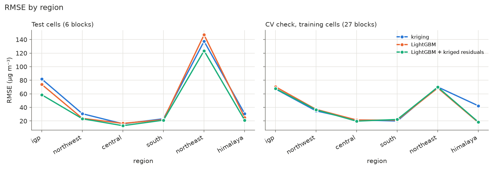
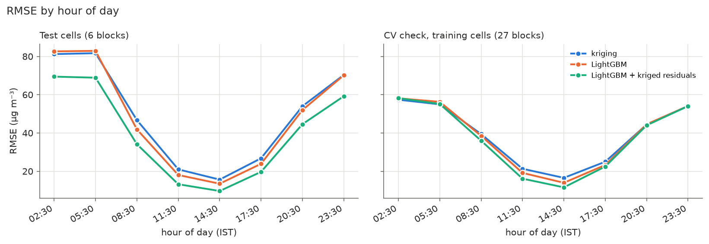
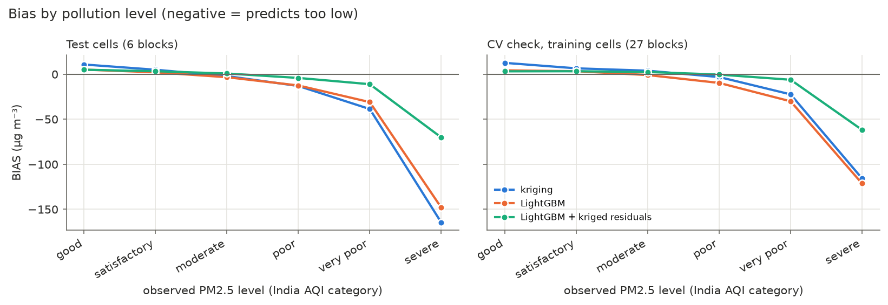
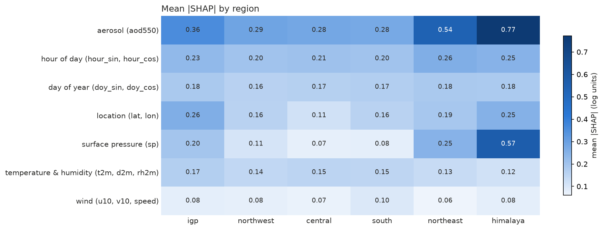
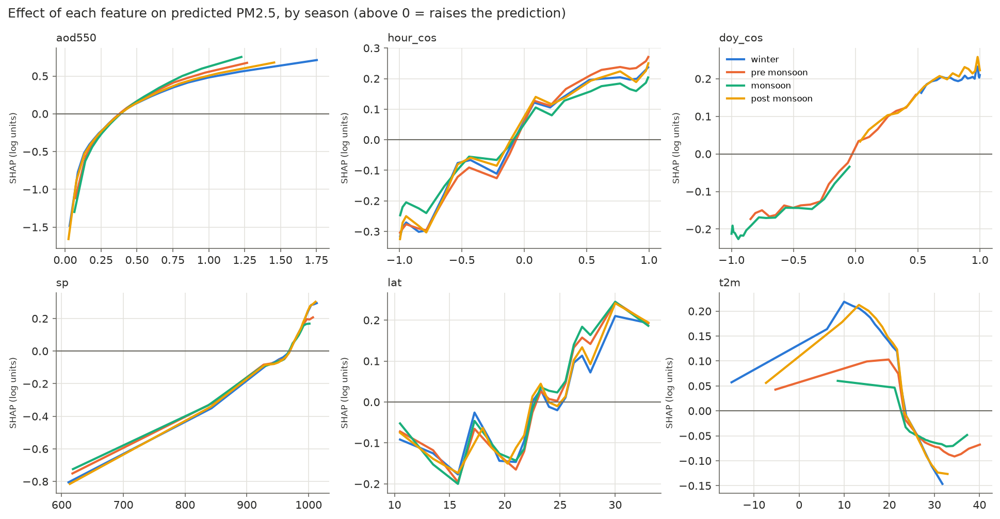
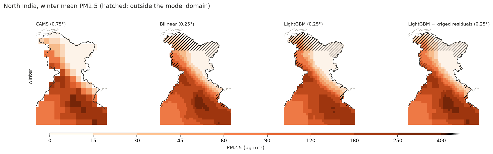

# Machine Learning for Spatial Enhancement of PM2.5 Prediction over India

*Course project 3, CAMS EAC4 reanalysis, India, 2020–2024.*
Detailed per-step documentation: [`docs/steps/`](steps/00_overview.md); timeline of
all work and decisions: [`docs/steps/journal.md`](steps/journal.md); terms:
[`docs/steps/glossary.md`](steps/glossary.md).

## Summary

We estimate fine particulate matter (PM2.5) over India from atmospheric and
aerosol variables of the CAMS EAC4 reanalysis (3-hourly, 0.75°, 2020–2024),
evaluate the models **only at grid locations not used in training** (whole
spatial blocks held out), and use them to produce 0.25° maps.

- **Accuracy (RQ1).** At held-out locations the best method explains about
  **two thirds of the variance**: R² 0.68, RMSE 41 µg m⁻³, MAE 19 µg m⁻³ over 27
  held-out blocks. The 6-block test set gives R² 0.72, but with very wide
  uncertainty.
- **Models (RQ2).** LightGBM is the best ML model (test R² 0.59; beats the neural
  network and random forest in 100% of bootstrap samples); linear models are far
  behind (R² 0.30), so the relationships are strongly non-linear.
- **Features (RQ3).** Aerosol optical depth matters most, followed by the daily
  and seasonal cycles, location and altitude (surface pressure); wind matters least.
- **Regions and seasons (RQ4).** Best in central India and the monsoon; worst in
  the northeast and in the pre-monsoon fire season, and at night. All methods
  under-predict the rare severe-pollution hours.
- **New locations (RQ5).** How much one method beats another depends strongly on
  *which* places are held out: with only 6 test blocks, a single block can decide
  a comparison.
- **ML vs interpolation (RQ6).** ML beats interpolation where neighbours are not
  representative (Himalaya; 100–300 km from known cells). Combining both
  (LightGBM + kriged residuals) removes LightGBM's low bias and halves the
  under-prediction of severe pollution, but over many held-out places its RMSE is
  only slightly better than kriging or LightGBM alone. Fine maps from interpolated
  CAMS fields add little verifiable detail.

## 1. Objective and research questions

Develop and evaluate ML models that estimate PM2.5 at a location *s* and time *t*
from CAMS atmospheric and aerosol conditions at the same *s* and *t*, test them at
CAMS grid locations not used for training, and use them to make spatially
enhanced PM2.5 maps over India.

1. How accurately can PM2.5 be estimated from CAMS atmospheric and aerosol variables?
2. How do different ML models compare?
3. Which atmospheric and aerosol features are most important?
4. How does performance vary across regions and seasons of India?
5. How well do the models generalise to grid locations not used in training?
6. How does ML-based spatial enhancement compare with standard spatial interpolation?

## 2. Data

**Source.** CAMS global reanalysis EAC4 (Copernicus Atmosphere Data Store), a
chemistry–weather model with assimilated satellite observations. Box 6–38° N,
68–98° E; native grid 0.75° × 0.75° (~80 km); **3-hourly** (00, 03, …, 21 UTC);
**2020-01-01 to 2024-12-31: 14,616 time steps**, 60 monthly downloads, no gaps,
no missing values.

| Variable | Role | Units used |
|---|---|---|
| PM2.5 (`pm2p5`) | target | µg m⁻³ |
| AOD at 550 nm (`aod550`) | predictor | – |
| 10 m wind u, v (`u10`, `v10`) | predictors | m s⁻¹ |
| 2 m temperature, dewpoint (`t2m`, `d2m`) | predictors | °C |
| surface pressure (`sp`) | predictor (≈ altitude) | hPa |
| derived: wind speed, relative humidity, local solar hour (sin/cos), day of year (sin/cos) | predictors | – |
| latitude, longitude | predictors | ° |

**Domain.** The **494 grid cells** at least 50% inside India (Natural Earth 10 m
state boundaries), grouped into **6 regions** by state: Indo-Gangetic Plain (IGP,
84 cells), northwest (83), central (150), south (97), northeast (43), Himalaya
(37). The 50% rule excludes 127 border/coast cells, including the Mumbai and
Chennai cells (kept excluded by decision), and the island territories.
**Seasons** follow the India Meteorological Department: winter (Jan–Feb),
pre-monsoon (Mar–May), monsoon (Jun–Sep), post-monsoon (Oct–Dec).

**PM2.5 in the data.** Mean 72.2, median 51.9, 95th percentile 207, maximum
5,651 µg m⁻³ (Assam, March 2021, fire season). The IGP is 2–4 × more polluted
than other regions in winter (mean 218 µg m⁻³) and post-monsoon (207); the
northeast peaks in March (fires); every region is cleanest in the monsoon. PM2.5
is highest at night (02:30–05:30 IST) and lowest in the afternoon (14:30 IST)
everywhere: the shallow night-time boundary layer traps pollution. 2020 has the
lowest annual mean (66 µg m⁻³, COVID-19 lockdown).

## 3. Methods

### 3.1 Spatial hold-out

Neighbouring cells are strongly correlated: even after removing the predictors and
a large-scale trend, only ~30% of the variance is "new" between cells 75 km
apart, and the correlation length (variogram range) is ~900 km. Randomly held-out
cells would therefore have near-identical neighbours in training and give
inflated scores. We split by **blocks of 5 × 5 cells (~380 km)**, a compromise
between independence (~75–80% of the local correlation gone) and having enough
blocks (33) to balance regions: **95 test cells in 6 blocks (19%)**, **399
training cells in 27 blocks**, the latter divided into 5 cross-validation folds
of whole blocks. Test and training cells have the same mean PM2.5 (72.6 vs 72.1).
Test cells are a median 83 km (max 283 km) from the nearest training cell.

### 3.2 Methods compared

| Family | Method | Uses |
|---|---|---|
| Interpolation | nearest cell, inverse-distance weighting (IDW, 8 neighbours), Delaunay-linear (scattered-point bilinear), ordinary kriging (seasonal exponential variograms) | PM2.5 at training cells, same time step |
| Regression | linear regression; ridge; random forest; **LightGBM** (gradient-boosted trees); MLP (neural network) | predictors at the cell itself |
| Hybrid | **LightGBM + kriged residuals** (regression kriging); LightGBM + IDW residuals | both |

**Tuning.** Each ML model got the same budget: 8 random settings, scored by 5-fold
block-wise CV on training cells (5% of time steps), including the choice of raw or
log(1 + PM2.5) target. All non-linear models chose the log target. Final models
were fitted on all 5.8 M training rows (ridge, LightGBM) or 2 M rows (RF, MLP), and
every prediction is clipped to [0, training maximum].

**Hybrid.** LightGBM predicts PM2.5 from the predictors; its errors at training
cells (*out-of-fold*, i.e. from models that did not see those cells) are kriged to
the target cell and added. The residual variograms reach a sill at ~490 km.

### 3.3 Evaluation

RMSE, MAE, R² and bias on the test cells, overall and by region, season, distance
to the nearest training cell, hour of day, pollution level (India AQI
categories) and year. Because the test set is only 6 blocks:

- **Block bootstrap**: resample whole test blocks 2,000 times for 95% ranges of
  every score and of paired differences between methods.
- **CV check**: the same comparison on the 399 training cells, each fold
  predicted only from the other four (27 blocks). The hybrid uses **nested**
  residuals (20 extra model fits) so that a fold's own data never reaches its
  correction.

### 3.4 Feature importance and maps

**SHAP values** (exact TreeSHAP) of the final LightGBM on 200,000 rows from all
India cells, plus **permutation importance** on test cells for single features and
groups of related features. **Maps**: 0.25° grid inside India's **official
boundary** (Natural Earth, India point of view, including all of Jammu & Kashmir
and Ladakh); predictors interpolated bilinearly, then LightGBM and the hybrid
applied; compared with bilinear regridding and kriging of CAMS PM2.5.

## 4. Results

### 4.1 Accuracy and model comparison (RQ1, RQ2)

**Test cells (6 blocks, 1.39 M values)**, with 95% block-bootstrap ranges:

| Method | RMSE | 95% range | MAE | R² | bias |
|---|---|---|---|---|---|
| **LightGBM + kriged residuals** | 45.9 | 17.7–81.5 | **17.4** | 0.72 | −1.3 |
| LightGBM + IDW residuals | **45.0** | 21.1–77.2 | 18.8 | **0.73** | −1.6 |
| nearest cell | 53.7 | 25.2–84.1 | 24.0 | 0.61 | −7.9 |
| **LightGBM** | 55.0 | 19.5–98.2 | 19.1 | 0.59 | −7.9 |
| IDW | 55.1 | 25.3–92.6 | 23.8 | 0.59 | −7.2 |
| kriging | 55.6 | 21.6–96.1 | 22.6 | 0.58 | −6.7 |
| MLP | 59.2 | 22.7–105.1 | 21.8 | 0.53 | −11.0 |
| Delaunay-linear | 59.8 | 24.6–95.1 | 25.2 | 0.52 | −10.3 |
| random forest | 62.7 | 21.9–111.7 | 22.6 | 0.47 | −11.3 |
| ridge | 71.3 | 36.1–119.1 | 35.1 | 0.31 | −5.1 |
| linear regression | 72.0 | 37.2–119.3 | 36.8 | 0.30 | −6.8 |

**CV check (training cells, 27 blocks, 5.8 M values):**

| Method | RMSE | 95% range | MAE | R² | bias |
|---|---|---|---|---|---|
| **LightGBM + kriged residuals** | **41.1** | 29.5–52.7 | **19.2** | **0.68** | −0.4 |
| LightGBM | 41.9 | 30.4–53.1 | 19.4 | 0.66 | −6.3 |
| kriging | 42.0 | 31.2–52.8 | 21.1 | 0.66 | −0.5 |
| LightGBM + IDW residuals | 45.3 | 32.9–57.5 | 21.8 | 0.61 | −1.3 |
| IDW | 45.8 | 36.1–55.1 | 24.5 | 0.60 | +2.4 |
| nearest cell | 47.8 | 38.7–57.1 | 24.5 | 0.56 | +0.8 |

- **LightGBM is the best ML model**: it beats the MLP (−4.2 µg m⁻³ RMSE) and the
  random forest (−7.8) in every bootstrap sample. Linear models reach only
  R² ≈ 0.3: effects are non-linear and change with season (e.g. temperature is
  negatively related to PM2.5 in winter and positively in the monsoon).
- **Realistic accuracy** at a new location is R² ≈ 0.7 (RMSE ≈ 41, MAE ≈ 19
  µg m⁻³), with a plausible range of about 0.5–0.8 depending on the location.
  RMSE is dominated by rare extremes; MAE is the better guide to the typical error.

### 4.2 ML vs interpolation, and the hybrid (RQ5, RQ6)

Paired differences in RMSE (a − b), 95% range, and share of bootstrap samples in
which *a* is better:

| a vs b | test (6 blocks) | CV (27 blocks) |
|---|---|---|
| hybrid vs LightGBM | −9.0 (−15.7 to −1.1), 100% | −0.8 (−3.5 to +1.7), 71% |
| hybrid vs kriging | −9.6 (−15.4 to −3.4), 100% | −0.9 (−6.1 to +3.3), 65% |
| hybrid vs nearest | −7.8 (−18.0 to +2.0), 92% | −6.7 (−14.3 to +0.0), 97% |
| LightGBM vs kriging | −0.6 (−5.8 to +5.1), 60% | −0.1 (−3.8 to +2.5), 53% |
| kriged vs IDW residuals | +0.9 (−3.6 to +4.4), 33% | −4.2 (−5.7 to −2.7), 100% |

- The hybrid's large test-set gain (R² 0.59 → 0.72) comes almost entirely from
  **2 of the 6 test blocks** (northeast block 38: −25 µg m⁻³ RMSE; IGP block 50:
  −12). Over 27 CV blocks the correction helps in 15 blocks and hurts in 12, and
  the overall gain shrinks to ~1 µg m⁻³: it helps where the model's errors at
  neighbouring blocks carry over and hurts where they don't.
- **Robust on both sets:** (1) the hybrid **removes LightGBM's systematic low
  bias** (CV −6.3 → −0.4 µg m⁻³); (2) it **halves the under-prediction of severe
  pollution**; (3) kriging the residuals beats IDW of the residuals; (4) all ML
  methods beat nearest-cell copying.
- **Where ML beats interpolation:** in the **Himalaya**, interpolation fails
  (CV R²: kriging −0.05, nearest −1.23, LightGBM 0.81), because PM2.5 falls
  steeply with altitude and the nearest known cells are often on the plain. ML and
  the hybrid also win **100–300 km from known cells**; interpolation wins within
  100 km.

| CV RMSE by distance to nearest known cell | ≤ 100 km | 100–200 km | 200–300 km |
|---|---|---|---|
| LightGBM + kriged residuals | 29.4 | **40.8** | **49.7** |
| LightGBM | 30.1 | 41.9 | 50.6 |
| kriging | **25.7** | 41.9 | 56.4 |
| nearest cell | 29.4 | 47.3 | 67.5 |

### 4.3 Regions, seasons, hours and pollution levels (RQ4)

R² by region:

| Method | IGP | northwest | central | south | northeast | Himalaya |
|---|---|---|---|---|---|---|
| test: hybrid | 0.74 | 0.68 | 0.86 | 0.69 | 0.53 | 0.86 |
| test: LightGBM | 0.59 | 0.67 | 0.78 | 0.67 | 0.34 | 0.80 |
| test: kriging | 0.50 | 0.44 | 0.80 | 0.63 | 0.42 | 0.70 |
| CV: hybrid | 0.62 | 0.61 | 0.79 | 0.53 | 0.24 | 0.80 |
| CV: LightGBM | 0.58 | 0.60 | 0.75 | 0.57 | 0.26 | 0.81 |
| CV: kriging | 0.62 | 0.65 | 0.74 | 0.62 | 0.23 | −0.05 |

- **Central India is easiest, the northeast hardest** (R² 0.23–0.53): pre-monsoon
  fire plumes are local and not described by the predictors.
- **Seasons:** best in the monsoon (CV R² 0.77), worst in the pre-monsoon (0.47).
- **Hours:** errors are 4–5 × larger at night (02:30 IST, RMSE ~58) than in the
  afternoon (14:30 IST, 12–17), following the daily cycle of PM2.5 itself.
- **Pollution level:** every method under-predicts "severe" hours (≥ 250
  µg m⁻³, ~3% of rows): bias −116 (kriging), −121 (LightGBM), −62 (hybrid).

### 4.4 Feature importance (RQ3)

| Feature group | mean \|SHAP\| (log units) | RMSE increase when shuffled (µg m⁻³) |
|---|---|---|
| aerosol (AOD) | **0.35** | 11.4 (largest MAE increase, +12.5) |
| hour of day | 0.22 | 13.9 |
| day of year | 0.17 | 14.5 |
| location (lat, lon) | 0.17 | **18.8** |
| surface pressure (altitude) | 0.15 | 10.2 |
| temperature & humidity | 0.15 | 7.5 |
| wind | 0.08 | 5.5 |

- **AOD is what the model uses most** (typical effect ±35–40%), rising steeply
  and then flattening with AOD.
- **Location matters most for accuracy at new places**: lat/lon carry
  large-scale emission patterns no other feature describes (removing them: test
  R² 0.59 → 0.48).
- **Daily and seasonal cycles**: predictions are ~30% higher at local night and
  ~25% lower around noon (boundary layer), ~20% higher in winter and lower in the
  monsoon.
- **Altitude**: surface pressure lowers predictions by up to ~55% at 600 hPa
  (~4,000 m); with AOD it dominates the Himalaya. **Cold raises PM2.5 only in
  winter and post-monsoon.** In the pre-monsoon, weather explains least (fires).

### 4.5 Spatially enhanced maps (RQ6)

Seasonal means at 0.25°; hatched areas (PoK, Aksai Chin, excluded coastal cells)
are inside India's official boundary but outside the area the models were
trained and evaluated on.

| Fine map averaged back to 0.75° vs CAMS | RMSE | R² | bias |
|---|---|---|---|
| bilinear | **8.9** | **0.985** | −0.3 |
| LightGBM + kriged residuals | 10.5 | 0.979 | −0.2 |
| kriging | 15.8 | 0.952 | −0.3 |
| LightGBM alone | 28.9 | 0.841 | −3.5 |

- All methods show the same large-scale picture: the IGP hotspot in winter and
  post-monsoon, a clean Himalaya and south, a clean monsoon except the desert
  northwest.
- The hybrid stays almost as faithful to CAMS as bilinear regridding and differs
  from it by 2–6 µg m⁻³ on average (most in the IGP, Himalayan foothills,
  northeast). It adds some plausible detail at the plain-to-Himalaya transition
  (steepest gradients 11–14% sharper than bilinear) but keeps a visible imprint of
  the 0.75° grid (it equals CAMS at every CAMS cell centre).
- **LightGBM alone is not a good mapping method** (drifts from CAMS, biased low).

## 5. Discussion and limitations

- **CAMS is not ground truth.** All accuracies are agreement with a model
  reanalysis, not with measured air quality. CAMS is known to overestimate PM2.5
  over the IGP.
- **AOD and PM2.5 come from the same simulated aerosol field** in CAMS, so the
  strong AOD → PM2.5 link (and AOD's top importance) is partly built in. With
  satellite AOD and station PM2.5 the task would be harder and meteorology would
  likely matter more.
- **Small test set.** 6 test blocks with mostly one block per region make
  per-region test results anecdotal; the CV check (27 blocks) is the more reliable
  basis for comparisons. It slightly favours LightGBM, whose settings were tuned on
  the same folds.
- **No validation below 0.75°.** The fine maps can only be checked for consistency
  with CAMS. Their extra detail comes from the model's learned response to
  interpolated predictors; real enhancement would need fine-resolution inputs
  (elevation model, satellite AOD at 1–10 km, emission or population maps) and
  fine-resolution reference data.
- **Domain choices.** Cells less than 50% inside India (incl. Mumbai and Chennai)
  and the island territories are excluded from training and evaluation. The region
  mask follows the de facto boundary; the maps use India's official boundary, with
  the difference hatched.
- **Reproducibility across machines.** The project was run on two machines
  (Fedora, macOS). Tree models and interpolation give identical results; the MLP
  does not (test R² 0.545 vs 0.528 with the same seed). An IDW tie-breaking
  difference between machines was found and fixed (stable sort). Reported numbers
  are from the macOS re-run.

## 6. Conclusions

1. From CAMS atmospheric and aerosol variables, PM2.5 at unseen locations can be
   estimated with R² ≈ 0.7 and a typical error of ~19 µg m⁻³; errors concentrate
   in severe-pollution hours, at night, in the northeast and in the fire season.
2. Gradient boosting (LightGBM) is the best of the ML models tested.
3. AOD, the daily and seasonal cycles, location and altitude drive the predictions.
4. ML and interpolation are complementary: ML wins where neighbours are not
   representative (mountains, far from data), interpolation close to known cells.
   Their combination removes the ML model's bias and reduces peak
   under-prediction, but its average accuracy gain over the best single method is
   small and location-dependent.
5. Evaluation with only a few held-out blocks can badly over- or under-state such
   gains; a block bootstrap and a cross-validation check over many blocks are
   needed before drawing conclusions.

## 7. Reproducing the results

Environment: `conda env create -f environment.yml` (env `pm25`), ADS credentials
in `~/.cdsapirc`. Run from the repository root:

| Step | Command | Time (macOS, 16 GB) |
|---|---|---|
| 01 Download | `conda run -n pm25 python scripts/download_eac4.py` | ~6 h (ADS queue) |
| 02 Region mask | `conda run -n pm25 python scripts/build_region_mask.py` | seconds |
| 03 Preprocessing | `conda run -n pm25 python scripts/preprocess_eac4.py` | ~1 min |
| 04 Exploration | `conda run -n pm25 python scripts/explore_eac4.py` | ~30 s |
| 05 Splits | `conda run -n pm25 python scripts/make_splits.py` | seconds |
| 06 Baselines | `conda run -n pm25 python scripts/run_baselines.py` | ~15 s |
| 07 ML models | `conda run -n pm25 python scripts/train_models.py --n-iter 8 --cv-time-frac 0.05` | ~40 min (or `--cv-from results/07_models/all/cv_results.csv`: ~4 min) |
| 08 Hybrid | `conda run -n pm25 python scripts/run_hybrid.py` | ~9 min |
| 09 Evaluation | `conda run -n pm25 python scripts/evaluate.py` | ~25 min |
| 10 Feature importance | `conda run -n pm25 python scripts/feature_importance.py` | ~20 min |
| 11 Maps | `conda run -n pm25 python scripts/make_maps.py` | ~11 min |
| 12 Report figures | `conda run -n pm25 python scripts/report_figures.py` | ~10 s |

Tests: `conda run -n pm25 python -m pytest` (73 tests). Data, `.nc` prediction
files and fitted models are not in git; every script writes its settings and
results to `results/logs/<script>.log` and `results/<step>/config.json`.
