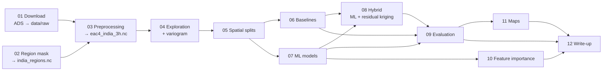

# Pipeline overview

One file per step in this folder. Each step doc has the same sections: purpose,
how it works, inputs/outputs, how to run, decisions (with reasons), results and
checks, open issues. Each script also appends a run log (command, git version,
settings, results) to `results/logs/<script>.log`.
**[journal.md](journal.md)** is the dated timeline of everything done, decided
or changed across steps.
**[glossary.md](glossary.md)** explains every technical term in plain language.

## Status

| # | Step | Status | Doc | Research questions |
|---|------|--------|-----|--------------------|
| 01 | Download EAC4 | **Done** (60/60 months, 17:55 on 2026-10-18) | [01_download.md](01_download.md) | prerequisite |
| 02 | India mask and regions | Done, **open issue: Mumbai/Chennai cells excluded** | [02_region_mask.md](02_region_mask.md) | RQ4 |
| 03 | Preprocessing | **Done** on 2020–2024 (14,616 steps, 632 MB) | [03_preprocessing.md](03_preprocessing.md) | RQ1, RQ3, RQ4 |
| 04 | Exploration, variogram | **Done** on 2020–2024 | [04_exploration.md](04_exploration.md) | RQ4, RQ5, RQ6 |
| 05 | Spatial block splits | **Done**: 5×5 main, 8×8 sensitivity; rerun if mask changes | [05_splits.md](05_splits.md) | RQ5 |
| 06 | Baselines (nearest, IDW, Delaunay-linear, kriging, linear) | **Done** on 2020–2024 | [06_baselines.md](06_baselines.md) | RQ6, reference for RQ1–2 |
| 07 | ML models (ridge, RF, LightGBM, MLP) | **Done**: LightGBM best (test R² 0.59) | [07_models.md](07_models.md) | RQ1, RQ2, RQ5 |
| 08 | Hybrid ML + residual kriging | **Done**: test R² 0.72 (vs 0.59 ML, 0.58 kriging) | [08_hybrid.md](08_hybrid.md) | RQ6 |
| 09 | Evaluation (overall, region, season, hour) | Not started | | RQ1, RQ2, RQ4, RQ5, RQ6 |
| 10 | Feature importance | Not started | | RQ3 |
| 11 | Maps | Not started | | RQ6 |
| 12 | Write-up | Not started | | all |

## Research questions (from docs/PROJECT.md)

1. How accurately can PM2.5 be estimated from CAMS atmospheric and aerosol variables?
2. How do different ML models compare?
3. Which atmospheric and aerosol features are most important?
4. How does performance vary across regions and seasons of India?
5. How well does the model generalize to grid locations not used in training?
6. How does ML-based spatial enhancement compare with standard interpolation?

## Project-wide decisions

| Date | Decision | Reason |
|------|----------|--------|
| 2026-10-18 | Native **3-hourly** data (8 steps/day), not 6-hourly or daily | Keeps the full diurnal cycle (incl. ~20:30 IST evening peak). Memory is tight (15 GB RAM, often ~4 GB free): subsample rows/time steps for heavy models instead of coarsening. |
| 2026-10-18 | Domain = India land cells (≥50% of cell inside India) | Project is about India; sea and neighbouring countries have different sources. See step 02 open issue. |
| 2026-10-18 | Boundaries = Natural Earth 10 m admin-1 | Free, has all 36 states/UTs; note it uses the de facto line of control in Kashmir, not India's official boundary. |
| 2026-10-18 | 6 regions: igp, northwest, central, south, northeast, himalaya | Groups states with similar pollution climate; needed for RQ4. |
| 2026-10-18 | IMD seasons: winter Jan–Feb, pre-monsoon Mar–May, monsoon Jun–Sep, post-monsoon Oct–Dec | Official India Meteorological Department definition. (The first plan said DJF; corrected.) |
| 2026-10-18 | Spatial split by blocks, not random cells | Neighbouring cells are strongly correlated; random hold-out inflates scores (CLAUDE.md rule). Block size set in step 04 from the variogram. |
| 2026-10-18 | **5 × 5-cell blocks (~380 km)**, 20% test, 5 CV folds, seed 42; 8 × 8 as sensitivity | Detrended variogram range 846 km would give only 11 blocks; at 380 km ~75–80% of local correlation is gone and 33 blocks allow region balance. See 04/05 docs. |

## Known limitations (carry into the write-up)

- **CAMS is not ground truth.** All "accuracy" is agreement with the CAMS model,
  not with real air quality. CAMS is known to overestimate PM2.5 over the
  Indo-Gangetic Plain (Delhi cell Jan 2020 mean: 381 µg m⁻³).
- **Target and AOD come from the same aerosol model.** EAC4 PM2.5 and AOD are both
  computed from the same simulated aerosol fields, so high skill from AOD is
  partly built in.
- **No truth below 0.75°.** Enhanced (finer) maps can be shown but not validated;
  validation is only possible at held-out CAMS cells.

## Tooling (not pipeline steps)

- `scripts/export_session.py` + SessionEnd hook (`.claude/settings.json`): every
  Claude Code session is archived to `logs/sessions/` as raw `.jsonl` + readable `.md`.
- `src/pm25/logging_utils.py`: `setup_logging()` and `log_run_info()` used by all scripts.
